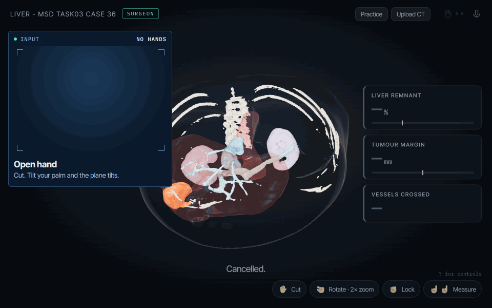
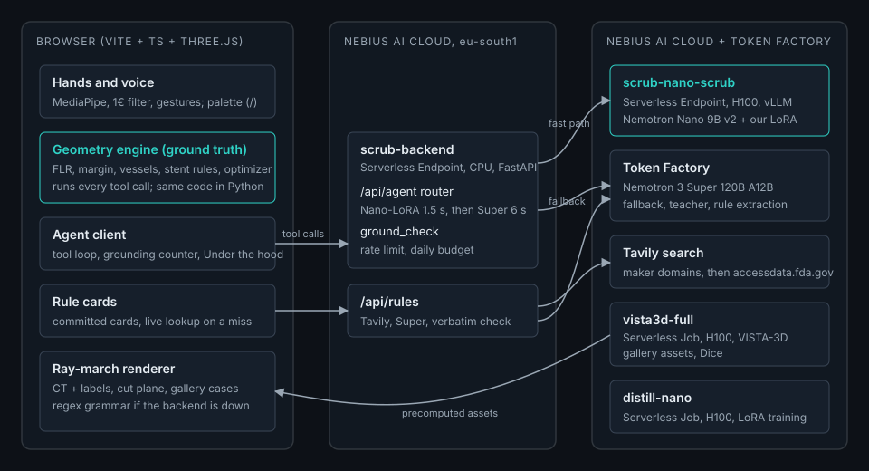
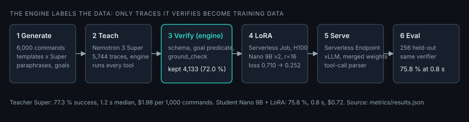

# Scrub+

**A surgical planning agent built entirely on NVIDIA open models.** A gloved hand in front of a laptop webcam rotates and slices a real CT volume. Voice or typed commands plan a liver cut or size an aortic stent graft. The geometry engine is the ground truth: it generates verified training data, Nebius AI Cloud distills a fast Nemotron agent from it, and nothing the agent says can contain a number the engine did not compute. Patient CT never touches a closed model.



Scrub+ v1 won 1st place overall at HackNC 2026. This README covers v2, built for the Nebius x NVIDIA Global AI Hackathon (track: Best Apps and Agents).

## Demo

- **Hosted app:** https://scrubplus.vercel.app/app/
- **Video (under 3 minutes):** _link added at submission_
- **Landing page:** https://scrubplus.vercel.app

### Try it without a webcam or microphone

1. Open https://scrubplus.vercel.app/app/ in Chrome. Click **Skip, use mouse** on the tutorial.
2. Click **Gallery** and pick the top case (MSD liver case 39, segmented by VISTA-3D on Nebius).
3. Press `/` and type `optimize the cut with a 10 mm margin`. Then type `resect`.
4. Type `open the aorta case`, then `size a stent for a Gore Excluder`. The rule card shows the IFU limits Tavily found, with source links, and the verdict uses them.
5. Type `write the plan`. Click **Under the hood** to see every agent call: model, latency, tools, grounded.

Mouse: drag to rotate, shift-drag to move the cut plane, scroll to zoom, click two points to measure, **alt-click to ask VISTA-3D "what's this?"** (on the cut face, it segments whatever the cut passes through). `?` lists the keyboard shortcuts.

**Your own scan:** click **Upload CT** and choose a `.nii.gz`. It opens in the browser first. If it has no labels, **Segment on Nebius** sends it to a VISTA-3D Serverless Job and shows the job's real stages (UPLOADED, SEGMENTING, CENTERLINE, READY) until the planned case opens.

This path runs cold against production in our scripted check (`node scripts/judge-path.mjs`, results in `metrics/judge_path.json`).

## Results

Every number below comes from a file in `metrics/`. The full tables, with methods, are in [docs/RESULTS.md](docs/RESULTS.md).

### Agent: 256 held-out commands

Each command runs end to end with the Python engine executing every tool call. A command succeeds when its machine-checkable goal holds on the final engine state (for example `margin >= 10 and vessels_crossed == 0`). The held-out set uses phrasings no model was trained on (see [Distillation](#the-distillation-pipeline) for how the split was made).

| Model | Task success | Schema valid | Grounded | Median latency | p95 latency | Cost per 1,000 commands |
|---|---|---|---|---|---|---|
| Nemotron 3 Super (Token Factory) | 77.3 % | 99.6 % | 88.7 % | 1.2 s | 4.6 s | $1.98 |
| Nemotron 3 Nano 30B A3B, few-shot (Token Factory) | 46.1 % | 100.0 % | 96.5 % | 7.1 s | 13.2 s | $0.61 |
| Nemotron Nano 9B v2, base (our Nebius endpoint) | 46.1 % | 98.4 % | 98.8 % | 0.9 s | 1.2 s | $0.39 |
| **Nemotron Nano 9B v2 + our LoRA (our Nebius endpoint)** | **75.8 %** | **100.0 %** | **91.0 %** | **0.8 s** | **2.1 s** | **$0.72** |
| Router: Nano-LoRA first, Super on escalation | 75.0 % | 100.0 % | 91.8 % | 0.8 s | 2.1 s | $0.76 |

Source: `metrics/results.json`.

- The distilled 9B model reaches 98 % of the 120B teacher's success rate (75.8 / 77.3), at 0.8 s median against 1.2 s, and 36 % of its cost per command.
- LoRA training moved the 9B model from 46.1 % to 75.8 % success.
- The router escalated 3.1 % of commands to Super and did not raise success. The LoRA's main failure is running out of rounds (15 of 256 commands), which per-round escalation checks cannot see. We report it as measured.
- Grounded means the model's own final sentence passed `ground_check` with no rewrite or template fallback. Every reply the app shows passes the check, because a failing reply is regenerated once and then replaced by a template built from tool results.

### VISTA-3D on Nebius: 8 MSD liver scans

| | Value |
|---|---|
| Liver Dice (median, 8 scans) | 0.967 (range 0.959 to 0.980) |
| Tumour Dice, scans with a lesion over 2 mL | 0.549 to 0.841 |
| VISTA-3D inference per scan (median, H100) | 5.2 s |
| Scan to app assets per scan (median) | 28.9 s |

Source: `metrics/vista_runs.jsonl`. **Dice** is the overlap between two masks, 2|A∩B| / (|A|+|B|), from 0 (no overlap) to 1 (identical). Lesions under about 1 mL are labelled as liver, so their tumour Dice is 0. VISTA-3D's training data includes MSD Task03, so these scans may have been seen in training.

### VISTA-3D at runtime: point prompts and uploads

| | Value | Source |
|---|---|---|
| Point prompt, VISTA-3D inference (H100, warm) | 0.72 s | `metrics/vista_point.jsonl` |
| Point prompt, round trip from a laptop to the endpoint | 2.0 s | `metrics/vista_point.jsonl` |
| First prompt on a case (prepares the volume) | 3.5 s on the endpoint | `metrics/vista_point.jsonl` |
| Prompt inside the liver: VISTA-3D's mask vs the case's liver label | 91.2 % of the mask is liver | `metrics/vista_point.jsonl` |
| Upload to READY, one 64 MB CT | 338 s: 4 min 39 s waiting for a GPU and the image, 65 s running | `metrics/spend.jsonl` |
| Of which VISTA-3D inference | 4.2 s | `metrics/spend.jsonl`, job `status.json` |

### Device rules from Tavily

The Gore Excluder card, extracted from goremedical.com and checked word for word against the source text: neck length ≥ 15 mm, neck diameter 19 to 32 mm, angulation ≤ 60°. Source: `data/device_rules/gore-excluder.json`. On the aorta case the neck measures 18.6 mm, so the Excluder is rejected on neck diameter, and the Excluder Conformable (16 to 32 mm) seals.

## NVIDIA models used

| Model | Exact ID | What it does | Where it runs |
|---|---|---|---|
| Nemotron 3 Super | `nvidia/nemotron-3-super-120b-a12b` | Teacher for the distillation data (paraphrases and 5,744 tool-calling traces); runtime fallback in the router; extracts IFU rules from Tavily results | Nebius Token Factory |
| Nemotron Nano 9B v2 + our LoRA | base `nvidia/NVIDIA-Nemotron-Nano-9B-v2`, served as `scrub` | The runtime agent: turns a request into tool calls, then a one-line grounded answer | Nebius AI Cloud Serverless Endpoint (vLLM 0.11, 1x H100) |
| Nemotron 3 Nano 30B A3B | `nvidia/NVIDIA-Nemotron-3-Nano-30B-A3B` | Few-shot baseline in the results table | Nebius Token Factory |
| VISTA-3D | `nvidia/NV-Segment-CT` | Segments liver, tumour, vessels, aorta and kidneys on every gallery CT and on uploaded scans; answers "what's this?" point prompts and names what it found | Nebius AI Cloud Serverless Job and Serverless Endpoint (1x H100 each) |

Model IDs were read from Token Factory's `GET /v1/models` (`metrics/tf_models.json`), not typed from memory.

## How Nebius Token Factory and AI Cloud are used

| Product | Resource | Why this product | Hardware |
|---|---|---|---|
| Token Factory | Nemotron 3 Super, OpenAI-compatible API | A 120B teacher and fallback with native tool calling, paid per token, no GPUs to manage | Managed |
| AI Cloud Serverless Job | `distill-nano`: LoRA fine-tune of Nano 9B v2 (`distill/job/`) | A one-off GPU run that stops by itself. Token Factory fine-tuning does not list Nemotron models | 1x H100 SXM, 64 min of training |
| AI Cloud Serverless Job | `vista3d-full`: segmentation and post-processing of the gallery and of each uploaded scan (`vista/job/`), started by the backend's `/api/scans` | Batch work on many scans, billed only while it runs | 1x H100 SXM |
| AI Cloud Serverless Endpoint | `vista3d-point`: VISTA-3D point prompts (`vista/point/`), behind the backend's `/api/segment-point` | Interactive: the model stays loaded, so a prompt answers in about 2 s; can be stopped when idle | 1x H100 SXM, eu-north1 |
| AI Cloud Serverless Endpoint | `scrub-nano-scrub`: vLLM serving the merged LoRA | Our own weights behind an OpenAI-compatible URL with a bearer token; can be stopped when idle | 1x H100 SXM, eu-north1 |
| AI Cloud Serverless Endpoint | `scrub-backend`: the FastAPI agent router (`backend/`) | A small always-on API next to the models; keys come from SecretStash | cpu-d3, 2 vCPU, eu-south1 |

**Cost per patient plan.** A plan is about six commands (load, optimize, resect, stent, card, plan). At the measured router cost of $0.76 per 1,000 commands that is $0.005. Segmenting a new scan takes a median 28.9 s on an H100, which is $0.036 at $4.50 per GPU-hour. Endpoint idle time is extra, which is why the endpoints are stopped outside recording and judging ([docs/OPERATIONS.md](docs/OPERATIONS.md)).

## Architecture



```
Browser (Vite + TS + three.js)
  ├─ hands, renderer, geometry engine (deterministic, runs every tool call)
  ├─ agent client ──► /api/agent  (scrub-backend, Nebius Serverless Endpoint, CPU)
  │                     └─ router: Nano-LoRA endpoint (1.5 s budget) ──► Nemotron 3 Super on Token Factory (6 s budget)
  ├─ rule cards ───► /api/rules   (Tavily search ──► Super extraction ──► verbatim check)
  ├─ upload ───────► /api/scans   (bucket ──► vista3d-full Serverless Job ──► planned case)
  ├─ alt-click ────► /api/segment-point (vista3d-point Serverless Endpoint, VISTA-3D point prompt)
  └─ gallery ──────► assets precomputed by the vista3d-full Serverless Job
```

The model never sees pixels and never computes a number. It picks tools; the browser's engine runs them on the CT and sends results back; the model answers in one sentence; `ground_check` rejects any number not present in this turn's tool results.

## The distillation pipeline



1. **Generate** (`distill/gen_commands.py`): 6,000 surgeon-style requests from templates x paraphrases x slot values, across all 13 tools, single and multi-step, with slang and some requests that should get a clarifying question. Super wrote the paraphrases. Fixed seed. Split: 5,166 train, 578 val, 256 test. With only two cases (liver and aorta), a split by case is not possible, so the test set is held out by phrasing: the last phrasing of each template appears only in test.
2. **Teach** (`distill/teach.py`): Super solves each train and val request with the Python engine executing its tool calls. 5,744 full traces.
3. **Verify** (`distill/verify.py`): a trace is kept only if every tool call is schema-valid, the final engine state satisfies the request's goal predicate, and the final text passes `ground_check`. **Kept 4,133 of 5,744 (72.0 %).** Dropped: 1,242 missed the goal, 183 ungrounded text, 176 errors, 10 invalid schema. The engine labels the data, so the training set is verified, not just generated.
4. **Train** (`distill/job/train.py`, Serverless Job): LoRA r=16, alpha 32, lr 1e-4 on q/k/v/o and up projections of layers 8 to 55, 1 epoch, max length 4,096. 8,850 training turns. Eval loss 0.710 before, 0.252 at the best step (`distill/runs/lora-1025-1456_train_log.json`). 3,846 s on one H100.
5. **Serve** (`distill/serve/launch.sh`): the adapter merged into the weights, served by vLLM with Nemotron's tool-call parser. vLLM 0.11 could not load a LoRA on this architecture, so merging was the documented fallback.
6. **Evaluate** (`distill/eval.py`): the same verifier on the 256 test commands, for every model in the table.

`make distill` reruns steps 1 to 3, `make distill-train` step 4, `make eval` step 6.

## Every number has a formula

| Number | Formula |
|---|---|
| Future liver remnant (FLR) | kept organ voxels / organ voxels x 100, organ = liver + tumour |
| Margin | minimum Euclidean distance transform value from the tumour, over kept organ voxels within one voxel diagonal of the plane; 0 if tumour is on the kept side |
| Vessels crossed | 6-connected vessel components within one voxel diagonal of the plane, inside the organ box, at least 120 mm³ |
| Tumour volume | tumour voxels x voxel volume, full-resolution labels |
| Resected volume | organ voxels on the resected side x voxel volume |
| Neck diameter | mean lumen diameter over the first 15 mm below the stent's proximal end, sampled every 1 mm |
| Neck length | length below the proximal end where lumen diameter stays within 10 % of the neck mean |
| Oversize | (device diameter - neck diameter) / neck diameter x 100 |
| Optimizer | local search of ±20° and ±15 mm around the current cut, then a wide search around the tumour if that is infeasible |
| Dice | 2 x overlapping voxels / (voxels in A + voxels in B) |

Each `measure` result carries its method string, so the formula travels with the number ([docs/TOOLS.md](docs/TOOLS.md)).

## What is AI and what isn't

| Part | AI? | How |
|---|---|---|
| Hand tracking | Yes | MediaPipe hand landmarks, then a 1€ filter and a gesture state machine |
| Understanding a request | Yes | Nemotron Nano 9B v2 + LoRA, Super on escalation; regex grammar if both fail |
| Segmentation of a new CT | Yes | VISTA-3D |
| "What's this?" | Yes | VISTA-3D point prompt; its volume in mL is counted from the returned voxels |
| Reading device rules from IFU pages | Yes | Super extracts; code checks each number against the quoted source text |
| FLR, margin, vessels, volumes, stent sizing and rules, optimizer | No | Deterministic geometry on the CT voxels, identical in TypeScript and Python (`make parity`, `make tool-parity`) |
| Any number the agent says | No | It must appear in this turn's tool results, or the sentence is replaced |

## Why it matters

- Severe post-hepatectomy liver failure occurs in about 13 % of patients, with mortality of 21 % or more (Reese et al., HPB, 2025). The remnant volume is what Scrub+ measures for every cut.
- Manual liver segmentation on CT took more than 34 minutes per scan in a 41-scan study ([Gotra et al., Academic Radiology](https://healthimaging.com/node/70333)). VISTA-3D does it in a median 5.2 s here.
- Screen-viewing time in the operating room went from 96 % to 10 % (Hansen et al., 2013).

## Privacy and deployment

Every model in Scrub+ has open weights. The runtime agent runs on our own Nebius endpoint, so the architecture can keep patient data inside one cloud account, with no call to a closed model API. Token Factory, the fallback, offers zero-retention inference, and Nebius AI Cloud is HIPAA-capable infrastructure. This describes what the architecture enables. Scrub+ itself has no certification and is not a medical device. CT in the hosted demo comes from public research datasets. An uploaded scan is read in the browser and stays there unless the user clicks **Segment on Nebius**; then it goes to the project's Nebius bucket and a VISTA-3D job, never to a closed model.

## Limits

- Hand depth is estimated from apparent hand size on a 2D webcam, which is enough to move the model and not a precise 3D position.
- Cuts are planar. Real liver resections follow Couinaud segments and curved surfaces.
- Stent flow is a 1D particle model, not CFD.
- IFU rules are simplified to four fields. A field Tavily cannot find verbatim falls back to a default rule, labelled as such.
- The data is from research datasets (MSD Task03, TotalSegmentator labels), not clinical cases.
- VISTA-3D weights are under the NVIDIA Open Model License, research use only.
- "What's this?" works with the mouse (alt-click) and the palette; the pointing-finger gesture from the plan is not built. A prompt works on the gallery, the demo cases and Nebius-segmented uploads, not on a scan opened only in the browser.
- An upload waits for a GPU: most of the 338 s we measured was provisioning and pulling the image, not segmentation.
- Not a medical device. Not for clinical use.

## What was built during this hackathon

Scrub+ was first built Oct 10 to 11, 2026 (inside the submission period, which opened Aug 26). Everything in the sections from "Results" through "Limits" of this README was added Oct 18 to 30:

- Oct 18 to 19: audit of v1, platform verification ([docs/PLATFORM_NOTES.md](docs/PLATFORM_NOTES.md)), FastAPI backend, first Nemotron 3 Super tool call.
- Oct 19 to 20: 13 agent tools in TypeScript and Python with parity tests; agent loop; `ground_check` with the HUD counter; command palette; Under the hood drawer.
- Oct 22: VISTA-3D Serverless Job on H100; 8-scan gallery with Dice.
- Oct 22 to 25: the distillation pipeline: 6,000 commands, 5,744 teacher traces, engine verification, LoRA Serverless Job, vLLM Serverless Endpoint, eval of five configurations.
- Oct 25 to 26: Tavily rule cards with verbatim validation, driving stent verdicts.
- Oct 28: backend as a Serverless Endpoint with rate limits and a daily budget kill switch; closed-model code removed; hosted judge path checked end to end.
- Oct 29: uploads segmented on Nebius (`/api/scans`, a VISTA-3D job per scan, real progress stages); "what's this?" point prompts on a VISTA-3D Serverless Endpoint.

The HackNC write-up (inspiration, gestures, challenges) is kept in [docs/README_hacknc.md](docs/README_hacknc.md).

## Setup

Requirements: Node 20+, Python 3.11 with [uv](https://docs.astral.sh/uv/), Chrome. Copy `.env.example` to `.env` and fill in the keys you have.

```bash
make install     # npm ci, uv sync, secret-scanning pre-commit hook
make dev         # backend on :8787 and the app on :5173
make test        # typecheck, lint, vitest, pytest
make e2e         # Playwright, fails on any console error
python pipeline/run.py liver --ct ... --labels ... --seg ...   # CT to app assets (see pipeline/run.py)
make distill     # commands -> teacher traces -> verified SFT files (Token Factory key)
make distill-train  # LoRA Serverless Job on Nebius
make eval        # every configured model on the test split -> metrics/results.json
make results     # rebuild docs/RESULTS.md from metrics/
make deploy      # backend as a CPU Serverless Endpoint at the pushed commit
```

Without any keys the app still runs: the regex grammar and the engine need no network. Starting and stopping the Nebius endpoints is in [docs/OPERATIONS.md](docs/OPERATIONS.md).

## Licenses and data credits

- Scrub+ code: MIT ([LICENSE](LICENSE)).
- Medical Segmentation Decathlon (Task03 Liver): CC BY-SA 4.0.
- TotalSegmentator: code Apache 2.0, data CC BY 4.0.
- VISTA-3D (`nvidia/NV-Segment-CT`): code Apache 2.0, weights NVIDIA Open Model License, research use only.
- Nemotron 3 Super, Nemotron 3 Nano, Nemotron Nano 9B v2: NVIDIA Open Model License.
- Tavily: used under the Tavily Terms of Service; rule cards cite each source URL.
- MediaPipe: Apache 2.0. three.js: MIT.

Platform feedback for Nebius and NVIDIA: [docs/FEEDBACK.md](docs/FEEDBACK.md).

## Team

[avidnerd](https://github.com/avidnerd).
