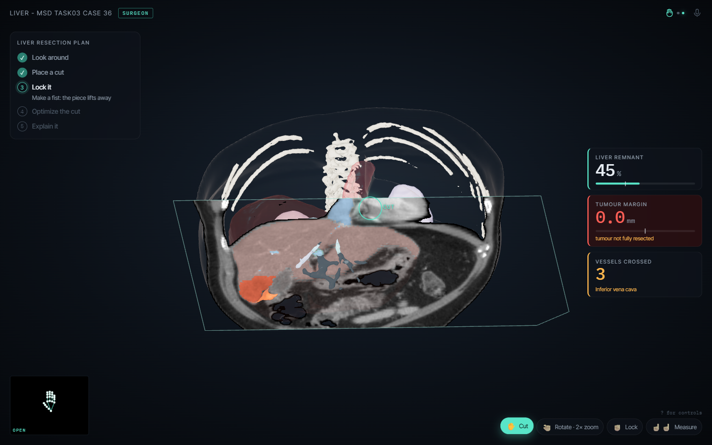
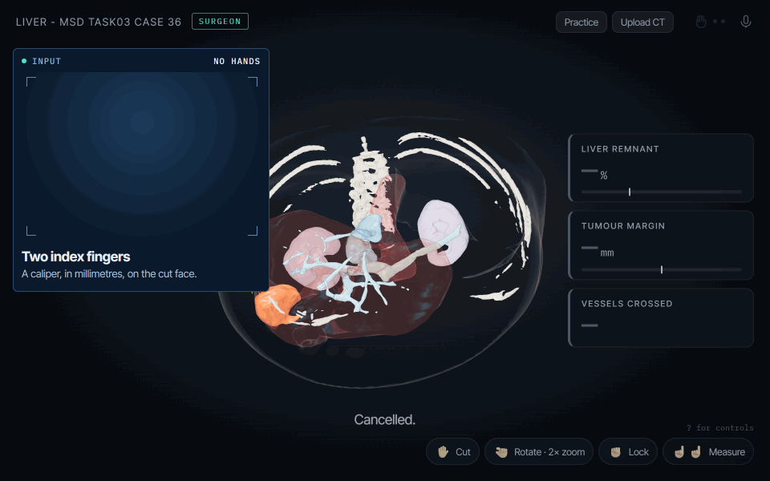
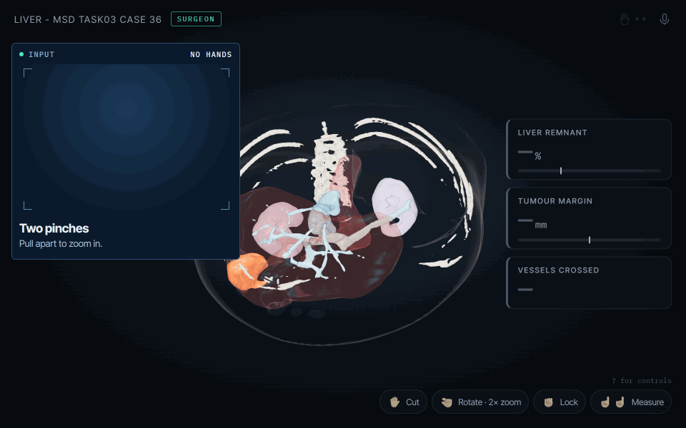
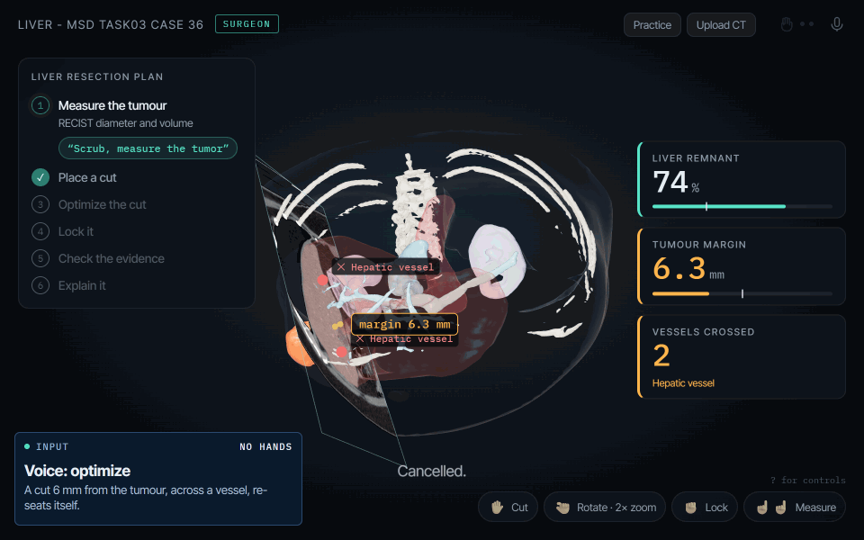
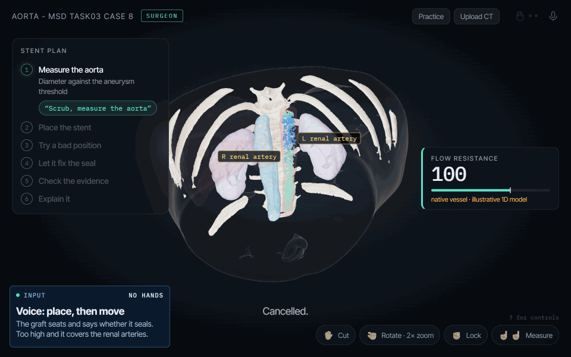

# Scrub+



my submission for HackNC 2026 :)

> rethinking how surgeons interact with medical imaging, without touching a computer.

# problem

Surgeons often need to reference CT scans and other medical images during operations. But once they're scrubbed in, they can't use a regular mouse or keyboard without compromising sterility.

- Instead, they have to ask someone outside the sterile field to navigate the images for them.
- Finding a specific structure, changing the viewing angle, or taking a measurement can require multiple rounds of verbal instructions.
- In a [2016 study](https://journals.plos.org/plosone/article?id=10.1371/journal.pone.0153596), completing an image-navigation task by directing an assistant took an average of 246 seconds, compared with 215 seconds using gestures.

Touchless medical image viewers have been developed to address this, but they have limitations:

- Most focus on basic controls like scrolling, zooming, and rotating. Surgeons still have to manually find what they're looking for.
- They generally don't support more complex tasks like measuring distances between anatomical structures or comparing surgical plans.
- Some require specialized cameras or other hardware.

The problem isn't just that surgeons can't touch the computer. **It's that getting a specific piece of information from a scan can take far more steps than it should.**

Scrub+ addresses both problems by letting surgeons use hand gestures and voice commands to navigate 3D CT scans, find anatomical structures, take measurements, and explore surgical plans.

# inspiration

My dad recently had to undergo an urgent heart procedure because of serious coronary blockages. It was a complicated case, and my family had a hard time finding a specialist who could perform it.

While all of this was happening, I spoke with some of the medical staff and got more interested in the practical side of how complex procedures work. I also started reading about problems with medical imaging workflows, including the pressure on radiology teams.

That experience wasn't specifically about touchless controls. It was what got me thinking about healthcare problems that could be approached from an engineering perspective.

I eventually came across touchless CT viewers that let surgeons control medical images using hand gestures. While the idea was really cool, I noticed a few limitations with existing approaches:

- Most only support basic navigation like scrolling through slices, zooming, and rotating images; essentially replacing a mouse with hand gestures.
- Surgeons still have to manually search through scans to find specific anatomical structures or the information they need.
- They don't support more advanced tasks like measuring the distance between a tumor and a blood vessel or comparing different surgical plans.
- Some also require specialized hardware, like depth cameras, rather than a regular laptop webcam.

I built Scrub to address all these limitations.

# design goals

- **touchless controls** using a laptop webcam and voice commands, without a headset or depth camera
- **less manual navigation** when someone wants to find a particular structure or measurement
- **real CT data** rather than a generic anatomy model
- **actual calculations** for distances, volumes, and margins instead of asking an LLM to guess
- **mouse and keyboard fallbacks** because webcam tracking and speech recognition aren't always reliable

# the copilot

The main idea is being able to say "scrub, show me..." instead of manually finding the right angle and slice.

| command | what it does |
|---|---|
| "scrub, show me the tumor relative to the portal vein" | highlights both structures, measures their closest gap, and moves the camera to show it |
| "scrub, show me where the tumor is closest to a major vessel" | searches the available vessel segmentations and shows the closest point with a CT cross-section |
| "scrub, focus on the left kidney" | finds and frames the kidney |
| "scrub, save this plan" | saves the current cut and view |
| "scrub, show me the original plan" | restores the saved plan |
| "scrub, compare this cut to the original plan" | compares the margin, remnant volume, and vessel intersections |
| "scrub, go back to the previous view" | returns to the previous view |

The language model interprets requests that fall outside the predefined voice commands, while all measurements are calculated directly from the CT data and segmentation masks.

# your own scans

You can load your own CT with the "Upload CT" button, the `I` key, or by dropping a `.nii` / `.nii.gz` file on the page. It is read in the browser and never uploaded anywhere.

- A CT on its own can be rotated, cut, windowed and measured.
- If you also add a label map that uses the MSD liver convention (1 = liver, 2 = tumor), the planning tools and the copilot turn on. Other label values are shown as numbered structures instead of guessed organ names.

Segmentation is not done in the browser, so a scan without labels gets the viewing tools only. DICOM needs converting to NIfTI first (for example with dcm2niix).

# learning the gestures

On the first visit, a short tutorial runs on a simple practice object. Each step checks what your hand is doing and only moves on once the gesture works, with a hint when the pose is wrong. Every step also shows the mouse or keyboard alternative, and you can skip it. Press `H` or click "Practice" to run it again.

# functions

These are the gesture and voice-control demos from the app.

<table>
<tr>
<td width="50%"><br><b>Open hand — cut</b><br>Move and tilt a resection plane. The measurements change with it.</td>
<td width="50%"><br><b>Pinch and drag — rotate</b><br>Grab the 3D scan and turn it.</td>
</tr>
<tr>
<td><br><b>Two fingers — measure</b><br>Measure distances in millimeters.</td>
<td><br><b>Fist — lock</b><br>Freeze the cut and separate the resected part visually.</td>
</tr>
<tr>
<td><br><b>Two pinches — zoom</b><br>Pull your hands apart to zoom in.</td>
<td><br><b>"scrub, optimize"</b><br>Search nearby cutting planes using the current planning constraints.</td>
</tr>
<tr>
<td><br><b>"scrub, place the stent"</b><br>Place a virtual graft in the aorta and inspect its geometric fit.</td>
<td></td>
</tr>
</table>

**the clips are generated by replaying recorded hand-landmark sequences through the app.

# how i built it

- **CT data**
  - Used a liver CT from the Medical Segmentation Decathlon.
  - Processed the scan in Python and added anatomical labels using TotalSegmentator.
  - The processed data is included with the app so you don't need to run the Python pipeline to try it.

- **3D rendering**
  - Built a volume renderer with three.js and GLSL.
  - It renders the CT and segmentation labels together, so the tumor can be highlighted inside the liver.
  - A moving cutting plane exposes the inside of the volume.

- **Hand tracking**
  - MediaPipe tracks 21 landmarks on each hand.
  - A gesture state machine and smoothing help avoid unintended movements.
  - I also experimented with a small neural network for cases where fingers overlap.

- **Measurements and planning**
  - Liver remnant volume is calculated from the segmented liver voxels on either side of the cut.
  - Tumor margin uses a distance transform.
  - Vessel intersections come from the segmentation masks.
  - A plane search evaluates 3,751 nearby candidates.
  - There's also a virtual aortic stent demo with simplified sizing and flow calculations.

- **Voice**
  - The browser's speech recognition listens for "scrub."
  - Common requests use a predefined command parser.
  - An optional LLM helps interpret other phrasing, but can only select supported actions.

# challenges i ran into

- **Gesture controls weren't as intuitive as i expected**
  - my first version used palm angle to switch between rotating the scan and moving the cutting plane.
  - It was awkward to hold the right angle consistently.
  - i changed it to open hand for the cut and pinch for rotation.

- **Fingers overlap all the time**
  - MediaPipe can misread landmarks when fingers cover each other.
  - i added filtering and gesture-state logic.
  - The experimental neural network improved results on synthetic hand data.

- **A webcam isn't a depth camera**
  - i estimate relative depth from how large the hand looks on screen.
  - It's enough to move the model around, but it isn't a precise measurement of where your hand is in 3D.

- **CT volumes are big**
  - Rendering the scan, showing segmented anatomy, and updating planning calculations at the same time required preprocessing and optimization.

# accomplishments that i'm proud of

- i got a real CT volume rendering in the browser with live gesture controls.
- The planning measurements actually change when the cutting plane moves.
- i tested the measurement code against independent NumPy calculations.
- On one test cut, the plane search increased the measured margin from 6.3 mm to 10.2 mm and reduced the intersected segmented vessel components from two to zero. That's a geometric comparison, not evidence that the new cut would be better for a patient.
- The main viewer, gestures, measurements, and optimizer still work without an LLM.

# what i learned

- A gesture can be easy for a computer to recognize and still be annoying for a person to use.
- Getting a 3D scan to respond to your hand is one thing. Making it easier to find useful information is a different problem.
- The most useful role for AI here isn't to give surgical advice. It's to understand what someone is asking for and call the right tools.
- Real clinical use would require testing with surgeons, better reliability in an operating-room environment, and much more validation of the anatomy and planning calculations.

# running it

Use Chrome on a laptop.

```bash
npm install
npm run dev
```

Open the local URL shown in the terminal and allow camera and microphone access.

- No webcam: drag to rotate, shift-drag to move the plane, scroll to zoom, and click two points to measure.
- No microphone: the app has keyboard shortcuts.
- Press `D` to replay a recorded gesture sequence.
- Press `H` for the gesture tutorial and `I` to upload a CT. Add `?tutorial=0` to the URL to skip the tutorial.
- Copilot shortcuts: `J` for anatomical relationship, `N` for nearest vessel, `B` to save a plan, `U` to restore it, `Y` to compare, `Backspace` for the previous view, and `Esc` to cancel.

To run the tests and benchmark:

```bash
npm test
npm run e2e
npm run bench
```

More details are in the [demo script](docs/DEMO_SCRIPT.md), [benchmark notes](docs/BENCHMARK.md), and [clinical notes](docs/CLINICAL.md).

# built with

- TypeScript, Vite, three.js, WebGL / GLSL
- MediaPipe, Web Speech API
- Python, NumPy, SciPy, scikit-image, nibabel
- TotalSegmentator, Medical Segmentation Decathlon
- Playwright
- Gemini / Claude for command interpretation

# try it out

- [GitHub repository](https://github.com/avidnerd/hack-nc)

# data and limitations

The CT data comes from the Medical Segmentation Decathlon, with additional anatomical labels from TotalSegmentator. See [docs/CLINICAL.md](docs/CLINICAL.md) for data sources, licenses, and the limitations of the planning calculations.

Scrub+ is a hackathon prototype, not a clinically validated medical device.
